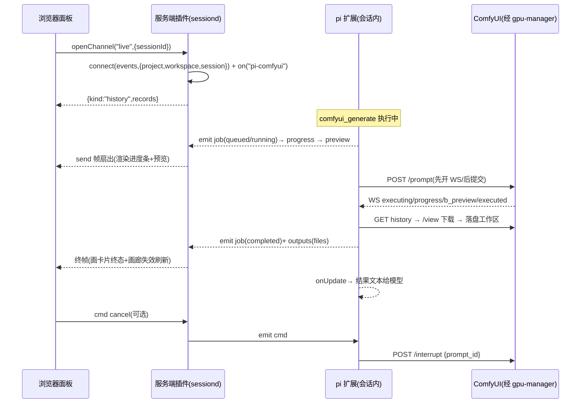

# 30 — pi-web 插件与 Wire 协议

> 本篇定义 `pi-comfyui` 包中 pi-web 插件(浏览器 v4 + 服务端 v3)的完整契约,以及扩展↔服务端↔浏览器的帧协议(`src/shared/protocol.ts` 单一来源)。
> 已核实的宿主契约来源:pi-web `src/plugin-api.ts`(browser v4)、`src/server-plugin-api.ts`(server v3)与 `pi-packages/captains-log` 参考实现(会话事件桥接、扇出、dataDirectory、peer channel 模式)。

## 1. 包声明

```jsonc
// package.json(与 pi 扩展同包,D1)
"piWeb": {
  "plugins": [{
    "id": "comfyui",
    "module": "./dist/plugin/browser/index.js",   // 浏览器入口 v4
    "serverModule": "./dist/plugin/server/index.js", // 服务端入口 v3
    "browserRoot": "./dist/plugin/browser",       // 浏览器静态资源根
    "machineSpecific": true,                      // 依赖节点本机 ComfyUI,按机器区分运行时
    "defaultEnabled": true
  }]
}
```

安装/启用与刷新方式见 50。浏览器与服务端**必须成对**(宿主规范:peer 必须提供 request 或 openChannel 之一,不可两者皆空)。

## 2. 浏览器插件(v4)

```ts
import type { PiWebPlugin, WorkspacePanelContext } from '@jmfederico/pi-web/plugin-api';
import { html } from 'lit';

const plugin: PiWebPlugin = {
    apiVersion: 4,
    name: 'ComfyUI',
    activate(ctx /* {apiVersion, pluginId, runtimePluginId, html, svg, signal, lifetimeSignal, selection?} */) {
        return {
            contributions: {
                workspacePanels: [
                    {
                        id: 'comfyui', // 面板限定 ID:"comfyui:comfyui"
                        title: 'ComfyUI',
                        icon: ctx.svg`<svg …>…</svg>`,
                        invalidationResources: ['workspace.files'], // 产物落盘自动失效重渲
                        onInvalidate: (c, inv) => store.requestRefresh(c, inv?.reason),
                        render: (context: WorkspacePanelContext) =>
                            html`<pi-comfyui-panel .ctx=${context}></pi-comfyui-panel>`,
                    },
                ],
                // applicationPanels: 二期(D9)
            },
        };
    },
};
export default plugin;
```

### 2.1 面板组件(pi-comfyui-panel,Lit)

**可用宿主能力**(WorkspacePanelContext,已核实):

| 能力                                                              | 用途                                                                                  |
| ----------------------------------------------------------------- | ------------------------------------------------------------------------------------- |
| `context.state.selectedSession.id`                                | 当前会话 id(**pending 时不稳定**,见 §4)                                               |
| `context.peer.openChannel("live", {sessionId}, {onData, signal})` | 打开实时帧通道(§5)                                                                    |
| `context.peer.request(operation, input, {signal})`                | 一次性请求:`list` / `summary` / `cancel`                                              |
| `context.files.listFiles(path)`                                   | 产物目录枚举(`comfyui-output`,目录不存在时优雅处理)                                   |
| `context.files.previewUrl(path)` / `downloadUrl(path)`            | 离盘产物 URL:`/<video>/<audio>` 直接引用;文件 >100KB 之类的宿主策略由 URL 侧解决 |
| `context.files.deleteFile(path)`                                  | 画廊"删除"操作                                                                        |
| `context.navigate({…, tool}) / context.navigation?.set(key, v)`   | 深链(如定位到某任务)                                                                  |
| `context.host.requestRender()`                                    | 状态变化触发宿主重渲                                                                  |
| `context.prompt`                                                  | "用此图继续"/"重新生成"类动作填充 prompt                                              |

### 2.2 UI 规格(D9 第一期)

- **运行卡片**:当前任务(generator 名、状态徽章 queued/running/completed/failed/cancelled、阶段文本)。
- **进度条**:`progress` 帧 `value/max`;多节点时显示 `当前节点名 value/max`。
- **实时预览**:`preview` 帧 → ``;**从未收到 preview 帧时整个预览区隐藏**(D5,不显示占位、不报错)。
- **取消按钮**:running/queued 时可见 → `peer.request("cancel", {jobId})`。
- **产物画廊**:`files.listFiles(outputDir)` 树/网格;缩略图 `img`/视频 `video`(muted controls preload=metadata)/音频 `audio`;hover 显示路径;点击 → `fileOpenQuery` 深链(实现以宿主 `fileOpenQuery` 约定为准,开发时对照);每项"下载"(downloadUrl)与"删除"(带确认)。
- **任务历史**:来自 `peer.request("list", {limit:50})`(服务端插件持久化,§3.3),每条显示时间/生成器/状态/产物数,可展开该任务的产物(若仍在工作区→同样用 previewUrl 呈现)。
- 状态与刷新:面板挂载即 `summary` + `list` 打底,`openChannel` 增量更新;`onInvalidate`(workspace.files 失效)→ 重枚举画廊。组件 `disconnectedCallback` 用传入的 `signal` 正确退订/关 channel。

### 2.3 浏览器渲染注意

- 最终媒体一律走**工作区文件的 previewUrl**,而不是 base64 常驻 DOM;大 gallery 懒加载(`loading="lazy"`,视频 `preload="metadata"`);预览图随帧替换,注意 revoke/避免闪烁(直接 `src` 覆盖即可)。
- 遵循宿主"render 是同步 Lit 模板、异步数据放 element 内部管理、尊重 signal"的模式(与 captains-log/terminal 一致)。

## 3. 服务端插件(v3)

```ts
import { PI_WEB_HOST_PI_SESSION_EVENTS_CAPABILITY } from '@jmfederico/pi-web/server-plugin-api';
import type { PiWebServerPlugin, ServerPluginActivationContext } from '@jmfederico/pi-web/server-plugin-api';

const plugin: PiWebServerPlugin = {
    apiVersion: 3,
    name: 'ComfyUI',
    requires: [PI_WEB_HOST_PI_SESSION_EVENTS_CAPABILITY],
    activate(host /* {pluginId, packageRoot, dataDirectory, logger, settings, execFile, signal, lifetimeSignal} */) {
        // …
        return {
            start({ capabilities }) {
                events = capabilities.resolve(PI_WEB_HOST_PI_SESSION_EVENTS_CAPABILITY);
            },
            peer: { request, openChannel },
            async dispose() {
                /* 关闭全部连接与订阅 */
            },
            health() {
                return { status: 'healthy' };
            },
        };
    },
};
export default plugin;
```

要点(照抄 captains-log 模式,已核实其可行性):

- `host.dataDirectory`:宿主创建的插件持久目录,**本插件负责全部文件格式**。
- `host.lifetimeSignal`:插件生命周期;所有监听/定时器挂它,`dispose` 做有界清理。
- 每个 peer 回调的 `signal` 只属于本次调用,**不得**当 lifecycle signal 用。
- `send(data)` 同步克隆+有界:单帧超限/队列溢出会 throw 并关闭 channel → 服务端要 try/catch send,失败即把该订阅者摘除(参考实现行为)。

### 3.1 会话桥接(与扩展通信)

- **订阅顺序铁律**:`connect()` 返回后**先** `on("pi-comfyui", handler)` 再发任何 cmd;扩展侧在 `session_start` 完成订阅(10 §7)。连接到"重连"场景时同样保持先订阅。
- 一次 `connect({projectId, workspaceId, sessionId})` 只覆盖一个会话;**会话切换/新会话 → 必须重新 connect**(宿主无会话路由,scope 只有 project/workspace/session)。
- `dispose` 时关闭所有 active connection(幂等 `close()`)。

### 3.2 peer.request 操作

| operation       | input                                    | 返回                                                       |
| --------------- | ---------------------------------------- | ---------------------------------------------------------- |
| `summary`       | `{}`                                     | `{ active?: JobSummary, queueLen: n, generatorCount?: n }` |
| `list`          | `{ limit?: ≤200, workspaceScope: true }` | `JobRecord[]`(倒序,含最终 files 相对路径与 error 摘要)     |
| `cancel`        | `{ jobId }`                              | `{ ok }` / `{ ok:false, error }`——转发为会话 cmd 帧(§6)    |
| `history-clear` | `{}`                                     | `{ ok }`(清 dataDirectory 历史,UI 加确认)                  |

### 3.3 持久化(任务历史)

`dataDirectory/jobs/`:

```
jobs/<projectHash>/<workspaceHash>.jsonl
```

- 每行一条 JobRecord(扩展通过 `kind:"job"` 终态帧 + `kind:"outputs"` 帧补全;服务端只做追加与截断,单文件 >2MB 时滚动轮转最旧的 50% )。
- JobRecord:`{ jobId, generator, title?, state, startedAt, endedAt?, durationMs?, files: [{path,size,mime}], error? , promptId? }`。
- `openChannel` 打开即发 `{kind:"history", records}`(最近 50 条)作为**初始状态帧**,浏览器断线重连后也能恢复。

## 4. 会话选择与边界

- 浏览器从 `context.state.selectedSession` 取 session id;`pending` 或无会话 → 面板显示"请先选择/创建会话",不 open channel。
- 若 workspace 里 pi 扩展未装/未启用 → 会话不存在本插件频道,channel 打开但等不到 job 帧;面板顶部提示"扩展未见活动"(由 `summary`/`list` 的 404 性错误识别)。
- 多标签页:每标签独立 openChannel;服务端对同一 `(project, workspace, session)` 维护 1 条 events 连接 + N 个 channel 订阅者扇出(capains-log 同款 Map)。
- 会话 `archived`/切换后:旧 channel 随其 signal abort 自动清理;不尝试跨会话恢复。

## 5. Wire 协议(`src/shared/protocol.ts`,唯一真相)

频道名:`"pi-comfyui"`(常量 `COMFYUI_CHANNEL`)。

### 5.1 扩展 → 服务端(经 `pi.events.emit`,无回放)

```ts
type ComfyJobState = 'queued' | 'running' | 'completed' | 'failed' | 'cancelled';

type ExtensionFrame =
    | {
          kind: 'job';
          jobId;
          state: ComfyJobState;
          generator;
          title?;
          phase?: string;
          message?: string;
          startedAt?;
          endedAt?;
          error?: string;
      }
    | { kind: 'progress'; jobId; value; max; node?: string; label?: string }
    | { kind: 'preview'; jobId; mime: 'image/jpeg' | 'image/png'; data: string /*base64*/ }
    | { kind: 'outputs'; jobId; files: { path; size; mime; subfolder?; type? }[] }
    | { kind: 'generators'; list: { name; title }[] };
```

限频与上限(扩展侧已保证,服务端只透传):progress 无独立限频(轻小);preview 最小间隔 800ms、单帧 ≤192KiB base64(10 §6);帧均为纯 JSON。

### 5.2 浏览器 → 服务端(channel `receive`,浏览器 `send`)

```ts
type BrowserFrame = { kind: 'cmd'; action: 'cancel' | 'history-clear'; jobId?: string };
```

### 5.3 服务端 → 浏览器(channel `send`)

```ts
type ServerFrame =
    | ExtensionFrame // 原样转发
    | { kind: 'history'; records: JobRecord[] } // openChannel 时首发
    | { kind: 'error'; message: string }; // 命令拒绝等
```

### 5.4 命令回流(服务端 → 扩展)

```ts
// 服务端 connection.emit("pi-comfyui", {kind:"cmd", action:"cancel", jobId})
```

## 6. 时序(正常生成)



## 7. 错误与恢复

| 场景                     | 行为                                                                                                |
| ------------------------ | --------------------------------------------------------------------------------------------------- |
| 会话 daemon 重启         | 服务端插件重新 activate;浏览器只需 reload 页面(连接重建 + history 恢复);扩展侧行为不受影响          |
| 会话 `/reload`(扩展重载) | events 频道订阅重建;正在跑的任务状态丢失 → 服务端下一次 job 帧纠正;面板对"无 active"按 summary 显示 |
| WS(pi-web 面板链路)断开  | 浏览器重开 channel;服务端 connect 幂等;历史打底帧恢复                                               |
| 服务端 send 抛错(帧超限) | 该订阅者摘除,记 logger.warn;其他订阅者不受影响                                                      |
| events 无回放            | 断线期间帧不补;终态以 history 帧与 workspace 文件为准                                               |
| 插件禁用                 | Settings 里 toggle;扩展仍在(独立安装),面板消失而已                                                  |
